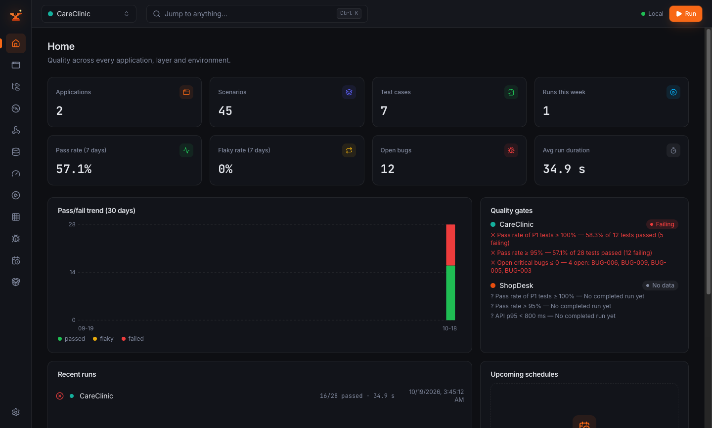
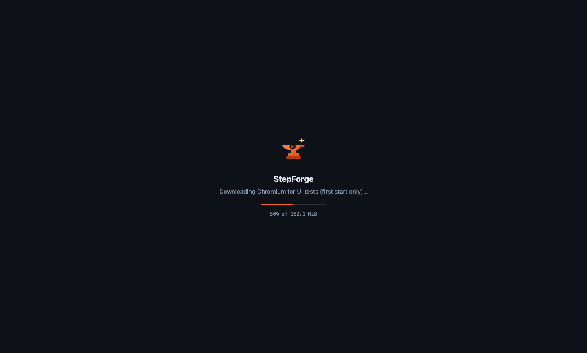

# StepForge as a desktop app (preview)

_By Md Zarin Tasnim · part of the StepForge documentation_



StepForge can run in its own window instead of a browser tab. It is the same StepForge: the same local server, the
same dashboard and the same data folder, so tests, runs and settings are shared with `npm start` and the CLI.

This is a **preview**: the installers are not signed yet (see [First start](#first-start)).

## Install

Download the installer for your computer from the
[GitHub releases](https://github.com/zarindev/StepForge/releases) (open the newest release, then **Assets**). Nothing
else is needed: no Node.js, no Git, no terminal. The installers are about 190–200 MB.

| Your computer | Download |
| --- | --- |
| Mac with Apple silicon (M1, M2, M3, M4 …) | [`StepForge-mac-arm64.dmg`](https://github.com/zarindev/StepForge/releases/latest/download/StepForge-mac-arm64.dmg) |
| Mac with an Intel processor | [`StepForge-mac-x64.dmg`](https://github.com/zarindev/StepForge/releases/latest/download/StepForge-mac-x64.dmg) |
| Windows 10 or 11 (64-bit) | [`StepForge-win-x64.exe`](https://github.com/zarindev/StepForge/releases/latest/download/StepForge-win-x64.exe) |
| Linux (64-bit) | [`StepForge-linux-x86_64.AppImage`](https://github.com/zarindev/StepForge/releases/latest/download/StepForge-linux-x86_64.AppImage) (any distribution) or [`StepForge-linux-amd64.deb`](https://github.com/zarindev/StepForge/releases/latest/download/StepForge-linux-amd64.deb) (Debian, Ubuntu, Mint …) |

Not sure which Mac you have? Open the Apple menu → **About This Mac**: "Chip: Apple M…" means Apple silicon, "Processor:
Intel …" means Intel.

### macOS

1. Open the downloaded `.dmg`.
2. Drag **StepForge** onto **Applications**, then eject the disk image.
3. Open **Applications** and **right-click StepForge → Open**, then **Open** in the dialog. This is needed once, because
   the app is not signed with an Apple Developer certificate yet; a normal double-click on the first start shows
   "StepForge can't be opened". If you already double-clicked: System Settings → **Privacy & Security** → scroll down →
   **Open Anyway**.
4. From then on, open it like any app (Launchpad, Spotlight, the Dock).

### Windows

1. Run the downloaded `.exe`.
2. If SmartScreen says "Windows protected your PC" (the installer is not signed yet): **More info** → **Run anyway**.
3. Choose who it is for and the folder (no administrator rights needed for "Only for me"), then **Install**.
4. Open **StepForge** from the Start menu or the desktop shortcut.

### Linux

**AppImage** (any distribution):

```bash
chmod +x StepForge-linux-x86_64.AppImage
./StepForge-linux-x86_64.AppImage
```

Some distributions need FUSE 2 for AppImages (Ubuntu 22.04 and later: `sudo apt install libfuse2`).

**.deb** (Debian, Ubuntu, Mint …):

```bash
sudo apt install ./StepForge-linux-amd64.deb
```

Then open **StepForge** from the applications menu (or run `stepforge`).

UI tests need Chromium's system libraries. On Debian or Ubuntu, after installing the `.deb`, StepForge's own copy of
Playwright installs them (no Node.js needed):

```bash
sudo env ELECTRON_RUN_AS_NODE=1 /opt/StepForge/stepforge \
  /opt/StepForge/resources/app/node_modules/playwright/cli.js install-deps chromium
```

With Node.js installed, `sudo npx playwright install-deps chromium` does the same. Other distributions: install the
libraries [Playwright lists](https://playwright.dev/docs/intro#system-requirements) for yours.

### First start



The first start downloads **Chromium** for UI tests (about 180 MB) and **Mailpit** for email tests (about 10 MB), with
progress on the start screen; then the dashboard opens. Later starts take a few seconds. Without internet, StepForge
opens anyway, says what it could not download, and tries again at the next start (UI tests need Chromium; everything
else works).

Then choose **Load demo workspace** on the welcome screen to see StepForge at work, or create your first application.

### Update

Download the newer installer and install it over the old one (macOS: replace the app in Applications). Your tests,
runs and settings are kept: they live in the data folder below, not in the app.

### Uninstall

- **macOS:** move StepForge from Applications to the Bin.
- **Windows:** Settings → Apps → **StepForge** → Uninstall.
- **Linux:** delete the AppImage, or `sudo apt remove stepforge`.

Your data stays in the data folder below; delete that folder too to remove everything. Chromium (shared with other
Playwright tools) is in `~/Library/Caches/ms-playwright` (macOS), `%LOCALAPPDATA%\ms-playwright` (Windows) or
`~/.cache/ms-playwright` (Linux).

### Where your data is

| System | Folder |
| --- | --- |
| macOS | `~/Library/Application Support/StepForge/data` |
| Windows | `%APPDATA%\StepForge\data` |
| Linux | `~/.config/StepForge/data` |

Set `STEPFORGE_DATA_DIR` to use another folder, for example the `data` folder of a clone to share its tests.

## From a clone

After `setup`, `npm run desktop` opens the same app from the repository: it runs on your Node.js and uses the
repository's `data` folder, so it shares everything with `npm start` and the CLI.

## How it behaves

- A window opens with a start screen and shows the dashboard a few seconds later.
- **Already running?** If StepForge is already running on the same data folder (for example with `npm start`), the
  window opens that server instead of starting a second one, and leaves it running when you quit the app.
- **Quitting** stops the server cleanly: a test that was running is marked *interrupted* and can be resumed, as with
  Ctrl+C in a terminal.
- **macOS:** closing the window keeps StepForge running in the Dock, so scheduled runs keep going; click the Dock icon
  to bring the window back, or quit with ⌘Q. On Windows and Linux, closing the window quits.
- **Links** to other sites open in your default browser; only the dashboard opens inside the app.
- **Phone apps:** installing Appium from the app downloads a separate Node.js for it (the app's own runtime has no
  npm), into the data folder.

## Menu

| Item | What it does |
| --- | --- |
| File → Open in Browser | The same dashboard in your default browser |
| File → Show Server Log | The server's output (`logs/desktop-server.log` in the data folder) |
| View | Reload, zoom and developer tools |
| Help | This documentation and the issue tracker |

## Settings

The app reads the same settings as `npm start` (`STEPFORGE_DATA_DIR`, `STEPFORGE_PORT` and the rest) from the
environment; from a clone, also from the repository's `.env`. One more, for the clone only:

| Variable | Default | Meaning |
| --- | --- | --- |
| `STEPFORGE_NODE` | `node` on the `PATH` | The Node.js (22 or newer) that runs the server |

## If it does not start

A message shows the last lines of the server's output and the path of the full log (File → Show Server Log). From a
clone, the usual causes are the same as for `npm start`: `setup` not run yet, or Node.js older than 22. "Node.js was
not found" means the app could not find `node`: install Node.js 22 or newer, or set `STEPFORGE_NODE` to its full path.

## Building the installers

```bash
npm run desktop:package                 # this system and processor; output in apps/desktop/release
npm run desktop:package -- --arch x64   # macOS: the Intel app on an Apple-silicon Mac
npm run desktop:package -- --dir        # the app folder only, no installer (quicker)
node apps/desktop/scripts/smoke.mjs     # start the built app and run the demo tests in it
```

Each system builds its own installers (the database module is compiled for it). CI builds all of them, starts each
app and runs the demo tests in it; a version tag attaches the installers to a draft GitHub release.
